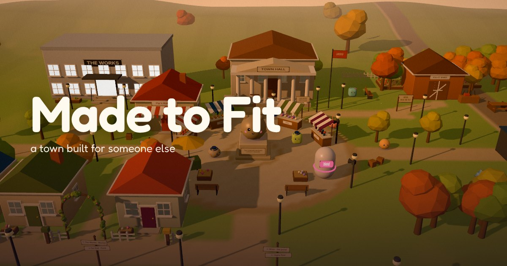

# Made to Fit

**[Play it in your browser](https://jvcobl.github.io/made-to-fit/)** (free, no sign-up, about fifteen minutes for the first day, on a laptop or a phone)

[](https://jvcobl.github.io/made-to-fit/)

A free 3D browser game about person-environment fit. You make a small creature, set up your room the way you like it, and step out into Larkspur, a cozy town planned around a statue of the "Standard Resident" that nobody actually matches. The town starts out muted. Wren's lantern shows what pinches the people who live there; you tag it, make room (a porch lantern, a quiet corner, a ramp argued for at a hearing), and color rolls back over each street you fix. The first day is a complete story of about fifteen minutes; two more days, and two short return visits ten and twenty years on, follow if you like.

The playable build is one self-contained HTML file (Three.js is bundled in; only Google Fonts load from outside). It runs on desktop and phone browsers, with keyboard, mouse or touch.

## What's in it
- **The first day (about fifteen minutes).** It opens on Larkspur from above, one crowd, until a thought appears over each person and the crowd turns out to be people in the middle of their own days (sonder). Raise Wren's lantern and sweep it round a street: the marks it finds are properties of the place (the speaker aimed at the benches, three steps and no ramp), each with who it pinches. Hang your own porch lantern (teal means come in, amber means not now) and the first wave of color rolls out from your door. In Market Square you pick between two designs, one of which costs Pomeroy his loud side, and listen to him before you build. At the Works you argue for a ramp at a short hearing, with the cards you collected, a free "Ask why", consent before you use someone's story, and a witness from the gallery. At dusk your guests arrive, Wren tunes the lantern to the Standard (nothing pinches it, and nobody fits it), and you sort the day's rewards: each came wrapped in a hook, the same kinds apps use. Whenever you stand still in town, someone walking past shows what their day is about.
- **Hooks in the open.** Every reward pop carries a small hook mark, and the phone's Hook Log says which pull it was (a head start, "1 left", a rare find, an open loop), with the research behind it. The reveal at the end of the day asks what each pull pointed you at. There is no real money, no notification, no real-time timer and nothing that punishes you for leaving; after the first day you can choose to play on quietly, without the hook marks or the sparks.
- **Tuesday and Wednesday.** The bus stop, the Works sync, Clover's find in the loft, ideas turned into proposals with backers, hearings at the town meeting, fixes in use, painting lanterns and the Lantern Festival, then an ending page.
- **Act 2, Ten Years On, and Act 3, Twenty Years On (one day each).** Your fixes in use and aged, a robot built to the founders' spec, a kiosk that listens to one kind of voice, a crossing timed to the Standard's stride, a newcomer whose needs are the opposite of yours, and the Shed in your hands.
- **Hands-on tasks.** The zoning sketch, sort, stamp, the plain note, fishing, painting lanterns, festival mail and teaching the robot the room as it is. Every task has a calm pace with no timer.
- **Saving.** The game saves on the device as you play and Continue returns to the same minute and spot. "Play on another device" in the menu gives a save code or a save file; "Played before?" on the title screen opens either. Nothing leaves the device unless the player copies it.
- **Access.** Text size, reading time (Normal, Longer, or Until I close it, and any notice pauses under the pointer and can be closed), reduced motion, calm feedback (fewer sparks and pops), an optional mood tint, captions for sounds, a calm task pace, remappable keys, a screen-reader feed for every line and card, and no flashing above three times a second. The game never simulates an impairment on the player's own eyes or ears: the lantern shows the place, not a distorted view.
- **Field notes.** Short notes with sources and evidence-strength tags, unlocked after the thing they describe has happened.

## Build
```
npm install
node build.mjs            # dist/who-bends.html, a full page for local play and tests
node build.mjs artifact   # dist/who-bends-artifact.html, without document tags, for publishing as a claude.ai artifact
```

## The live game, and picking this up in a new session
- **Play it at https://jvcobl.github.io/made-to-fit/** (GitHub Pages, served from the `gh-pages` branch of github.com/jvcobl/made-to-fit). This is the link to share. Don't rename the repo: GitHub redirects a renamed repo but not its Pages address, so the shared link would stop working.
- The same game is also the claude.ai artifact "Made to Fit" at https://claude.ai/artifact/2jE83aBf8Nmw5LxRsjp7HK, readable by anyone with the link. (The older "Who Bends" artifact is the first version; it is not the one to share.)
- **To ship a change:** run the tests that cover it, commit on `main` and push, then
  - `bash scripts/deploy-pages.sh` builds `dist/site/` (`node build.mjs site`) and pushes it to `gh-pages`; Pages updates within a minute or two.
  - For the artifact, `node build.mjs artifact` and publish `dist/who-bends-artifact.html` to the artifact URL with the Artifact tool. Read the artifact first (a publish to an existing URL needs that), and leave `capabilities` out so the page keeps the `downloads` grant it already has.
- **In a new Claude session:** attach the repo (jvcobl/made-to-fit, with push access), clone it, `npm install`, then work as above. A source zip works too if the repo isn't reachable.
- The website version (`node build.mjs site`) is the tested full page plus a description, link-preview tags (`site/og-image.jpg`, the title screen), the lantern icon (`site/favicon.svg` and its PNGs) and a canonical link. If the address ever changes, change `SITE_URL` in `build.mjs`.
- The design plan, its audit and the record of what changed live in the Claude Doc "Game Build Plan v3", https://claude.ai/artifact/AcHudQxxw4uX5Tt6E8huSV. Its tab "Next version: Look closer" plans the next round, starting with five cold playtests.

## Files
- `src/main.js`: the game loop and the world (movement, residents, crowds, autosave triggers, test hooks).
- `src/story.js`: Act 1 (prologue, days, cards, talk, fixes, the meeting, the festival, the ending) and saving.
- `src/slice.js`: the new game's first day. `src/marks.js`: the lantern's marks. `src/color.js`: street color and its waves. `src/hearing.js`: hearings. `src/hooks.js`: the hook marks and the Hook Log. `src/fx.js`: pops, sparks and chimes.
- `src/returns.js`, `src/act2.js`, `src/act3.js`, `src/talk23.js`: the return visits.
- `src/content.js`, `src/notes.js`: every word (cast, conversations, cards, endings, field notes).
- `src/sim.js`: the fit engine. `src/save.js`: saves, codes and validation. `src/files.js`: save files.
- `src/render.js`, `src/town.js`, `src/rooms.js`, `src/creature.js`, `src/robot.js`, `src/layers.js`, `src/lod.js`: the 3D world, built procedurally.
- `src/ui.js`, `src/menus.js`, `src/style.css`: the interface. `src/games/`: the tasks.

## Testing
URL parameters for local runs: `?test=1` (lighter rendering), `fast=1` (fast time, instant text), `mute=1`, `seed=N`, `v1=1` (the original first day, which most older tests use), `fixedstep=1` (nothing advances by itself; `window.__wb.step(n)` advances everything by n frames), `autosave=0`, `comfort=1`.

- `python3 test/slice.py <desktop|phone> <outdir> [seed] [good|blend]` plays the new first day start to finish with real keys, and prints how long each part took. `python3 test/slice_resume.py` checks that it saves and resumes mid-day.

- `python3 test/human.py <desktop|phone> <engaged|pusher|mixed> <outdir>` plays the whole game the way a person does (real clicks, taps and keys, the real clock), writes every word on screen to a transcript and screenshots each new screen. With `V2=1` it plays the new game, finishing the first day the usual way and playing Tuesday and Wednesday.
- `python3 test/autosave.py` checks saving as you play, Continue, leaving the page, the save code and the save file.
- `python3 test/tasks_view.py` screenshots every task on a laptop and a phone.
- `python3 test/keys.py` plays conversations with the keyboard only (E, Space, Enter) and checks that the key that closes the last line doesn't start the conversation again.
- `python3 test/reading.py` checks that text stays up long enough to read, pauses under the pointer, can be closed and waits with Until I close it, and that standing still in town shows a passerby's thought.
- `node test/check_content.mjs` checks every script (labels, conditions, flags, notes).
- `python3 test/play.py`, `act2.py`, `act3.py`, `saves.py`, `saves23.py`, `a11y.py`, `phone23.py`, `perf.py`, `flash.py` and the rest cover endings, the later visits, saves, accessibility (axe), phone layout, draw-call budgets and photosensitivity.

Build first (`node build.mjs`): the scripts load `dist/who-bends.html` from the repo they sit in, wherever it is cloned. Headless Chromium renders with SwiftShader: run browser tests one at a time on a small machine.

## Known gaps
- No cold human playtests yet; the automated players stand in for them (they play at 2.5 times the clock, so they tire faster than a person does).
- Mini-game timing was tuned in headless SwiftShader; check it on real phones and laptops.
- On a phone, a "Who adjusts?" card covers most of the screen, so your creature is out of view while you choose.
- Saves live in the browser (plus the save code and file); there are no accounts. Accounts would need a host of its own (for example GitHub Pages) and a sign-in service.
- Each resident has a few short conversations; a release would want more writing, and the Korean translation.
